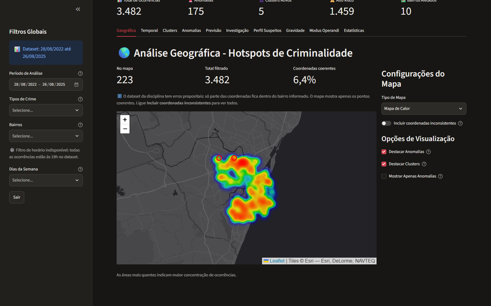

# 🚔 Sistema de Análise Criminal

> Projeto acadêmico (PI) — dashboard interativo em Streamlit para análise exploratória de ocorrências criminais, com validação de dados, clustering, detecção de anomalias e um modelo de classificação.

[](https://python.org)
[](https://streamlit.io)
[](https://github.com/<seu-usuario>/<nome-do-repositorio>/actions)

## 🎯 Sobre o projeto

Trabalho desenvolvido na faculdade (curso de Análise e Desenvolvimento de Sistemas) para praticar o ciclo completo de um projeto de dados: **carregar, validar, limpar, analisar e visualizar** informações de ocorrências policiais.

> ⚠️ **Aviso importante:** o dataset foi fornecido pelo professor e é **fictício**. Todos os nomes de delegacias, bairros e registros são usados apenas para fins didáticos. O sistema **não** representa dados reais da Polícia Civil nem de nenhum órgão público.

## 📦 Sobre os dados

O arquivo `data/dataset_ocorrencias_delegacia_5.csv` tem **5.000 ocorrências** (2022–2025) em **10 bairros do Recife**, com 14 colunas (tipo de crime, modus operandi, arma, vítimas, suspeitos, delegacia, status da investigação, coordenadas etc.).

O dataset contém **inconsistências propositais ou naturais de dados sintéticos**, e parte do trabalho foi identificá-las e tratá-las:

| Inconsistência encontrada | O que o projeto faz |
|---|---|
| Coordenadas que não correspondem ao bairro informado (apenas ~6% batem com o bairro) | Validação por bairro e por limites geográficos (`DataValidator`) |
| Coordenadas fora da área urbana considerada (~30% dos registros) | Registros removidos na limpeza: de 5.000 sobram **3.482** |
| Combinações incoerentes entre tipo de crime e modus operandi (ex.: furto com "Estupro Coletivo") | Identificado como limitação; não é possível corrigir sem a fonte |
| Ocorrências com 0 vítimas (inclusive homicídios) e com 0 suspeitos mas sexo do suspeito preenchido | Identificado como limitação dos dados |
| Delegacia responsável sem relação com o bairro da ocorrência | Identificado como limitação dos dados |

> 🔎 Como os dados parecem gerados aleatoriamente, **não existem padrões reais para os modelos aprenderem**. Os resultados de clustering e previsão devem ser lidos como demonstração técnica, e não como conclusão sobre criminalidade.

<!-- Depois de tirar os prints, coloque as imagens em docs/ e descomente:
## 🖼️ Screenshots


-->

## ✨ Funcionalidades

- **Dashboard com 10 abas:** geográfica, temporal, clusters, anomalias, previsão, investigação, perfil de suspeitos, gravidade, modus operandi e estatísticas.
- **Filtros globais:** período, bairros, tipos de crime, faixa horária e dias da semana.
- **Mapas:** mapa de calor, clusters e pontos individuais (Folium / PyDeck), com mapa base gratuito (Esri) que não exige chave de API. É possível trocar o provedor pelas variáveis `MAP_TILE_URL` e `MAP_TILE_ATTR`.
- **Machine Learning (scikit-learn, XGBoost, LightGBM):** K-Means, Isolation Forest e um classificador de ocorrência grave avaliado contra um baseline (acurácia e ROC AUC).
- **Módulo de segurança (demonstrativo):** login, criptografia Fernet dos arquivos gerados e log de auditoria.
- **Dashboard extra** de Violência Doméstica (`dashboard_violencia_domestica.py`).

## 📈 Resultados

| Etapa | Resultado | Interpretação |
|---|---|---|
| Limpeza | 5.000 → 3.482 registros válidos | Coordenadas inconsistentes foram descartadas |
| Clustering (K-Means) | Silhouette ≈ 0,10 | Clusters pouco definidos |
| Anomalias (Isolation Forest) | 175 registros (~5%) | Parâmetro de contaminação definido em 5% |
| Modelo de ocorrência grave | Acurácia CV 0,593 vs. baseline 0,601; ROC AUC 0,487 | **Não supera o acaso** |

O modelo tenta estimar se uma ocorrência é um crime grave (homicídio, latrocínio, estupro ou sequestro) a partir de bairro, dia, hora e mês. O resultado "ruim" é o esperado e **é um achado**: indica que o dataset não contém padrão real entre local/horário e gravidade.

## 🧪 Limitações conhecidas

- **Dados fictícios:** sem padrões reais, clustering e modelo preditivo servem como demonstração técnica de pipeline, não como conclusão sobre criminalidade.
- **Histórico do modelo:** uma versão anterior previa "nível de risco" calculado pela contagem de ocorrências por bairro e usava o bairro como variável de entrada, o que gerava ~100% de acurácia por **vazamento de alvo (*target leakage*)**. O alvo foi redefinido para algo que não depende das features, e o modelo passou a ser comparado com um baseline.
- A classificação "Baixo/Médio/Alto Risco" exibida em alguns gráficos é apenas **descritiva** (densidade de ocorrências por bairro) e não é prevista pelo modelo.
- **Segurança é apenas didática:** o login `admin/admin123` é de demonstração; as senhas usam SHA-256 sem sal e os arquivos usam `pickle`. **Não use em produção.** O painel de privacidade é ilustrativo e não constitui conformidade legal com a LGPD.
- Os testes cobrem login, criptografia, validação de dados e o alvo do modelo; não há testes automatizados de interface.

## 🛠️ Stack

Python · Streamlit · Pandas · NumPy · scikit-learn · XGBoost · LightGBM · Plotly · Folium · PyDeck · Matplotlib/Seaborn · cryptography

## 🚀 Como executar

```bash
# 1. Clonar o repositório
git clone https://github.com/<seu-usuario>/<nome-do-repositorio>.git
cd <nome-do-repositorio>

# 2. (Recomendado) criar ambiente virtual
python -m venv .venv
source .venv/bin/activate      # Windows: .venv\Scripts\activate

# 3. Instalar dependências
pip install -r requirements.txt

# 4. Gerar os resultados da análise
python advanced_analysis.py

# 5. Iniciar o dashboard principal
streamlit run enhanced_app.py

# 6. (Opcional) dashboard de Violência Doméstica
streamlit run dashboard_violencia_domestica.py
```

### Testes

```bash
pip install -r requirements-dev.txt
pytest -q
```

Acesso local: <http://localhost:8501>

**Login de demonstração:** usuário `admin`, senha `admin123` (criado automaticamente na primeira execução; é só um exemplo e não deve ser usado em produção).

## 📁 Estrutura

```
├── enhanced_app.py                      # Dashboard principal (login + 10 abas)
├── dashboard_tabs.py                    # Funções de cada aba
├── dashboard_violencia_domestica.py     # Dashboard de Violência Doméstica
├── advanced_analysis.py                 # Limpeza, clustering, anomalias e ML
├── security_utils.py                    # Login, criptografia e validação de dados
├── map_utils.py                         # Mapa base gratuito e sem chave de API
├── setup.py                             # Configuração inicial (opcional)
├── requirements.txt
├── requirements-dev.txt                 # pytest (opcional)
├── tests/
│   └── test_core.py                     # Testes automatizados
├── data/
│   └── dataset_ocorrencias_delegacia_5.csv
├── .github/workflows/tests.yml          # Testes automáticos (CI)
└── LICENSE.md
```

## 📄 Licença

Código distribuído sob a licença [MIT](LICENSE.md). O dataset em `data/` foi fornecido pelo professor e não é coberto por essa licença.