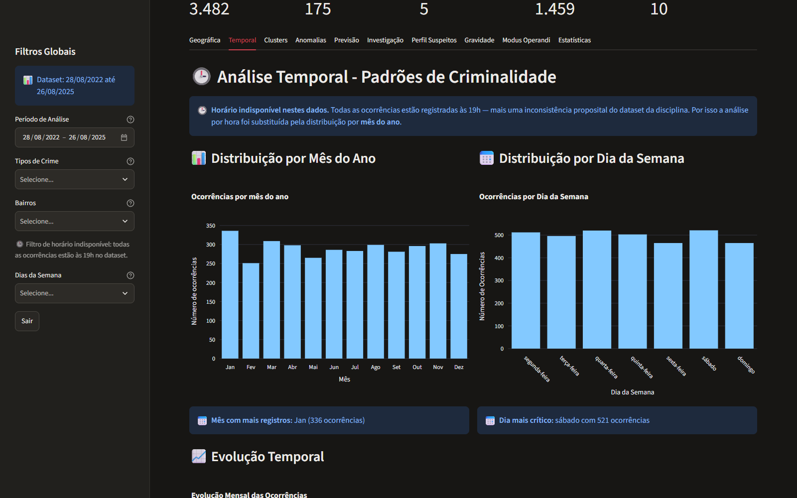
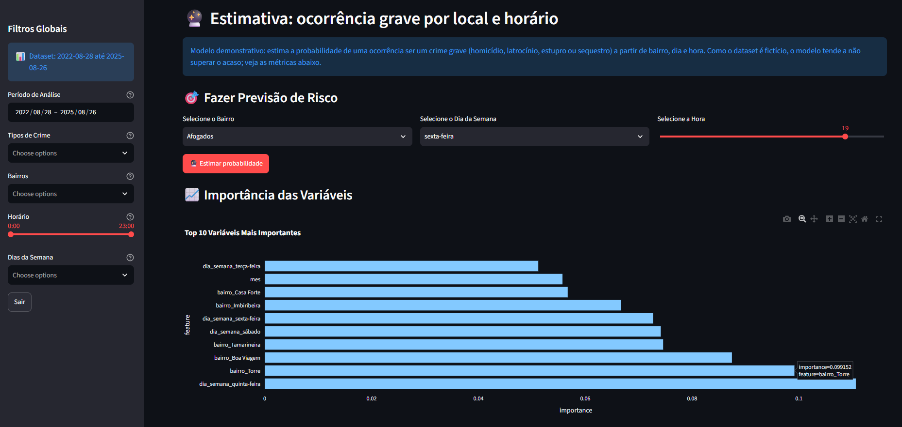
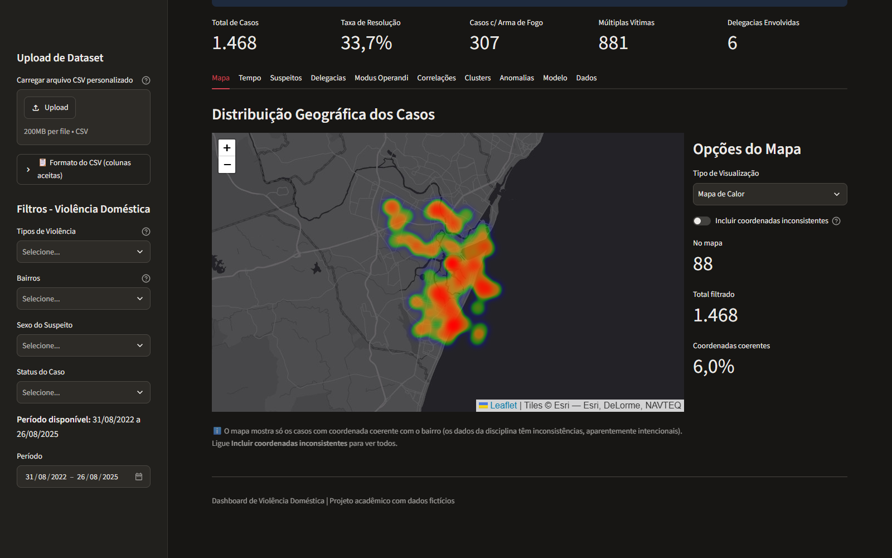

# 🚔 Sistema de Análise Criminal

> Projeto acadêmico (PI) — dashboard interativo em Streamlit para análise exploratória de ocorrências criminais, com validação de dados, clustering, detecção de anomalias e um modelo de classificação.

[](https://python.org)
[](https://streamlit.io)
[](https://github.com/binnahv/analise-criminal/actions)

## 🎯 Sobre o projeto

Trabalho desenvolvido na faculdade (curso de Análise e Desenvolvimento de Sistemas) para praticar o ciclo completo de um projeto de dados: **carregar, validar, limpar, analisar e visualizar** informações de ocorrências policiais.

> ⚠️ **Aviso importante:** o dataset foi fornecido pelo professor e é **fictício**. Todos os nomes de delegacias, bairros e registros são usados apenas para fins didáticos. O sistema **não** representa dados reais da Polícia Civil nem de nenhum órgão público.

## 📦 Sobre os dados

O arquivo `data/dataset_ocorrencias_delegacia_5.csv` tem **5.000 ocorrências** (2022–2025) em **10 bairros do Recife**, com 14 colunas (tipo de crime, modus operandi, arma, vítimas, suspeitos, delegacia, status da investigação, coordenadas etc.).

O dataset foi fornecido pelo professor e já veio com **inconsistências**, que tudo indica terem sido deixadas de propósito: parte do trabalho era justamente perceber esses problemas e decidir como tratá-los. O que foi encontrado:

| Inconsistência encontrada | O que o projeto faz |
|---|---|
| Coordenadas que não correspondem ao bairro informado (apenas ~6% batem com o bairro) | Validação por bairro e por limites geográficos (`DataValidator`) |
| Coordenadas fora da área urbana considerada (~30% dos registros) | Registros removidos na limpeza: de 5.000 sobram **3.482** |
| Combinações incoerentes entre tipo de crime e modus operandi (ex.: furto com "Estupro Coletivo") | Identificado como limitação; não é possível corrigir sem a fonte |
| Ocorrências com 0 vítimas (inclusive homicídios) e com 0 suspeitos mas sexo do suspeito preenchido | Identificado como limitação dos dados |
| Delegacia responsável sem relação com o bairro da ocorrência | Identificado como limitação dos dados |
| Todas as ocorrências registradas no mesmo horário (19h) | O app detecta isso, avisa na tela e troca a análise por hora pela análise por mês do ano |
| Coordenadas sorteadas num retângulo, e não em endereços reais | O mapa mostra só os pontos coerentes com o bairro; uma chave permite ver todos e enxergar o padrão |

> 🔎 Além dessas inconsistências, os dados são sintéticos e aleatórios, então **não existem padrões reais para os modelos aprenderem**. Os resultados de clustering e previsão devem ser lidos como demonstração técnica, e não como conclusão sobre criminalidade.

## 📸 Telas

**Mapa de calor:** só as coordenadas coerentes com o bairro, com a contagem do que foi descartado.


**Análise temporal:** o app detecta que todas as ocorrências estão às 19h e troca a análise por hora pela análise por mês.


**Previsão:** estimativa de ocorrência grave e importância das variáveis.


**Dashboard de Violência Doméstica:** upload de CSV, filtros e mapa.



## ✨ Funcionalidades

- **Dashboard com 10 abas:** geográfica, temporal, clusters, anomalias, previsão, investigação, perfil de suspeitos, gravidade, modus operandi e estatísticas.
- **Filtros globais:** período, bairros, tipos de crime, faixa horária e dias da semana. Quando todas as ocorrências têm o mesmo horário (caso do dataset da disciplina), o filtro de horário é escondido e a análise por hora vira análise por mês do ano.
- **Mapas:** mapa de calor, clusters e pontos individuais (Folium / PyDeck), com mapa base gratuito (Esri) que não exige chave de API. Por padrão o mapa mostra só as coordenadas coerentes com o bairro; uma chave permite incluir as inconsistentes. É possível trocar o provedor pelas variáveis `MAP_TILE_URL` e `MAP_TILE_ATTR`.
- **Machine Learning (scikit-learn, XGBoost, LightGBM):** K-Means, Isolation Forest e um classificador de ocorrência grave avaliado contra um baseline (acurácia e ROC AUC).
- **Módulo de segurança (demonstrativo):** login, criptografia Fernet dos arquivos gerados e log de auditoria.
- **Dashboard extra** de Violência Doméstica (`dashboard_violencia_domestica.py`), que aceita upload de CSV com formato documentado.
- **Interface em português do Brasil:** números (3.482; 33,7%), datas (dd/mm/aaaa) e títulos dos gráficos no padrão brasileiro. A página se declara `pt-BR`, então a tradução automática do navegador funciona corretamente.

## 📈 Resultados

| Etapa | Resultado | Interpretação |
|---|---|---|
| Limpeza | 5.000 → 3.482 registros válidos | Coordenadas inconsistentes foram descartadas |
| Clustering (K-Means) | Silhouette ≈ 0,10 | Clusters pouco definidos |
| Anomalias (Isolation Forest) | 175 registros (~5%) | Parâmetro de contaminação definido em 5% |
| Modelo de ocorrência grave | Acurácia CV 0,593 vs. baseline 0,601; ROC AUC 0,487 | **Não supera o acaso** |

O modelo tenta estimar se uma ocorrência é um crime grave (homicídio, latrocínio, estupro ou sequestro) a partir de bairro, dia, hora e mês. O resultado "ruim" é o esperado e **é um achado**: indica que o dataset não contém padrão real entre local/horário e gravidade.

## 🧪 Limitações conhecidas

- **Dados fictícios:** sem padrões reais, clustering e modelo preditivo servem como demonstração técnica de pipeline, não como conclusão sobre criminalidade.
- **Histórico do modelo:** uma versão anterior previa "nível de risco" calculado pela contagem de ocorrências por bairro e usava o bairro como variável de entrada, o que gerava ~100% de acurácia por **vazamento de alvo (*target leakage*)**. O alvo foi redefinido para algo que não depende das features, e o modelo passou a ser comparado com um baseline.
- A classificação "Baixo/Médio/Alto Risco" exibida em alguns gráficos é apenas **descritiva** (densidade de ocorrências por bairro) e não é prevista pelo modelo.
- **Segurança é apenas didática:** o login `admin` é de demonstração e sua senha é gerada aleatoriamente na primeira execução (nada de senha fixa no código); as senhas usam SHA-256 sem sal e os arquivos usam `pickle`. **Não use em produção.** O painel de privacidade é ilustrativo e não constitui conformidade legal com a LGPD.
- O dataset não tem dados da **vítima** (sexo, idade). Por isso os dashboards só mostram o perfil do **suspeito**.
- Os 17 testes cobrem login, criptografia, validação de dados e coordenadas, o alvo do modelo, o índice de gravidade, o upload de CSV, a formatação brasileira e a detecção do horário constante; não há testes automatizados de interface.

## 🛠️ Stack

Python · Streamlit · Pandas · NumPy · scikit-learn · XGBoost · LightGBM · Plotly · Folium · PyDeck · cryptography · pytest · GitHub Actions

## 🚀 Como executar

```bash
# 1. Clonar o repositório
git clone https://github.com/binnahv/analise-criminal.git
cd analise-criminal

# 2. (Recomendado) criar ambiente virtual
python -m venv .venv
source .venv/bin/activate      # Windows: .venv\Scripts\activate

# 3. Instalar dependências
pip install -r requirements.txt

# 4. Gerar os resultados da análise
python advanced_analysis.py

# 5. Iniciar o dashboard principal
streamlit run enhanced_app.py

# 6. (Opcional) dashboard de Violência Doméstica
streamlit run dashboard_violencia_domestica.py
```

### Testes

```bash
pip install -r requirements-dev.txt
pytest -q
```

Acesso local: <http://localhost:8501>

**Login de demonstração:** usuário `admin`. Na primeira execução o app gera uma **senha aleatória e a mostra no terminal** (aparece só uma vez):

```
============================================================
  LOGIN DE DEMONSTRAÇÃO CRIADO (aparece só desta vez)
  Usuário: admin
  Senha:   xxxxxxxxxxxx
============================================================
```

Para escolher a sua própria senha, defina a variável de ambiente antes de iniciar o app:

```bash
export ADMIN_PASSWORD="minha-senha"      # Windows (PowerShell): $env:ADMIN_PASSWORD="minha-senha"
streamlit run enhanced_app.py
```

> A senha só é definida quando o arquivo `users.pkl` é criado. Para trocá-la depois, apague o `users.pkl` e inicie o app de novo.

### Carregar outro dataset no dashboard de Violência Doméstica

O dashboard aceita um CSV próprio pela barra lateral (**Upload de Dataset**). Use o arquivo [`data/modelo_upload_violencia_domestica.csv`](data/modelo_upload_violencia_domestica.csv) como modelo; ele também pode ser baixado pelo próprio app, em **Formato do CSV**.

| Coluna | Obrigatória? | Formato |
|---|---|---|
| `data_ocorrencia` | Sim | `AAAA-MM-DD HH:MM:SS` (sem hora, todos os casos caem em 0h) |
| `tipo_crime` | Sim | Ex.: Violência Doméstica, Ameaça, Estupro |
| `bairro` | Sim | Nome do bairro |
| `latitude` / `longitude` | Sim | Decimal com ponto (ex.: `-8.112`, `-34.897`) |
| `arma_utilizada` | Não | Nenhum, Faca, Arma de Fogo, Objeto Contundente, Explosivos |
| `quantidade_vitimas` / `quantidade_suspeitos` | Não | Número inteiro |
| `sexo_suspeito` | Não | Masculino, Feminino ou Não Informado |
| `idade_suspeito` | Não | Número inteiro |
| `status_investigacao` (ou `status_atendimento`) | Não | Ex.: Em Investigação, Concluído, Arquivado |
| `orgao_responsavel` | Não | Delegacia/órgão responsável |
| `descricao_modus_operandi` | Não | Texto curto |

Sem as colunas opcionais o app funciona, mas as abas que dependem delas ficam limitadas. No mapa, pontos dos 10 bairros do dataset original precisam estar perto do centro do bairro informado; pontos de outros bairros são aceitos se estiverem dentro do Recife (latitude -8,16 a -7,93; longitude -35,02 a -34,85). Pontos fora disso não aparecem no mapa.

## 📁 Estrutura

```
├── enhanced_app.py                      # Dashboard principal (login + 10 abas)
├── dashboard_tabs/                      # Abas do dashboard principal
│   ├── mapa.py · padroes.py · previsao.py
│   └── investigacao.py · estatisticas.py
├── dashboard_violencia_domestica.py     # Dashboard de Violência Doméstica (página e main)
├── violencia_domestica/                 # Lógica do dashboard de VD
│   ├── dados.py                         # Carga, validação, filtros e formato do upload
│   ├── graficos.py                      # Abas descritivas (mapa, temporal, perfil...)
│   ├── modelos.py                       # Clustering, anomalias e modelo supervisionado
│   └── relatorio.py                     # Relatório HTML
├── advanced_analysis.py                 # Limpeza, clustering, anomalias e ML
├── security_utils.py                    # Login, criptografia e validação de dados
├── map_utils.py                         # Mapa base gratuito e sem chave de API
├── ui.py                                # Formatação pt-BR, gráficos padronizados e tratamento do horário
├── setup.py                             # Configuração inicial (opcional)
├── requirements.txt
├── requirements-dev.txt                 # pytest (opcional)
├── tests/
│   └── test_core.py                     # Testes automatizados
├── data/
│   ├── dataset_ocorrencias_delegacia_5.csv
│   └── modelo_upload_violencia_domestica.csv   # Modelo de CSV para upload
├── .github/workflows/tests.yml          # Testes automáticos (CI)
└── LICENSE.md
```

## 📄 Licença

Código distribuído sob a licença [MIT](LICENSE.md). O dataset `data/dataset_ocorrencias_delegacia_5.csv` foi fornecido pelo professor e não é coberto por essa licença; o arquivo modelo de upload é fictício e faz parte do projeto.